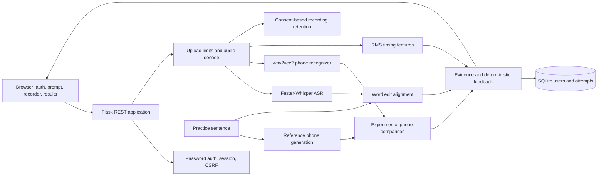
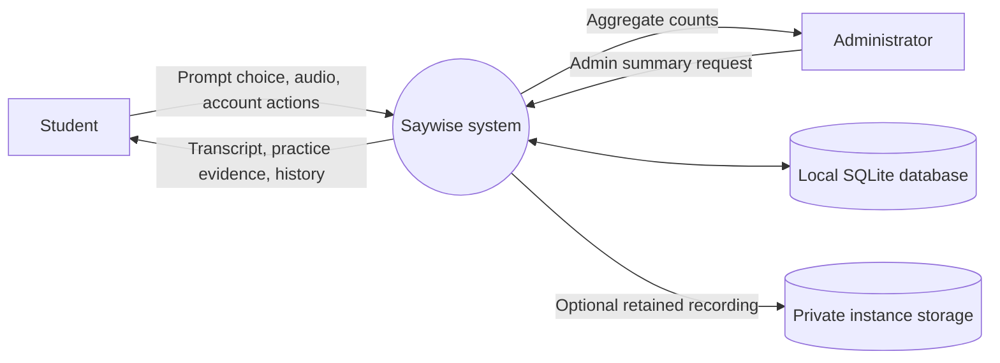
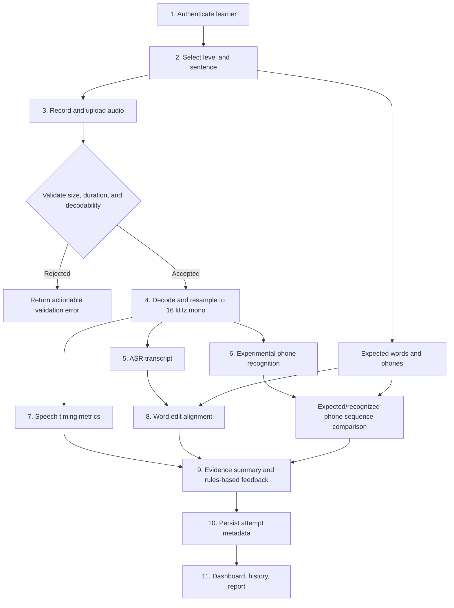
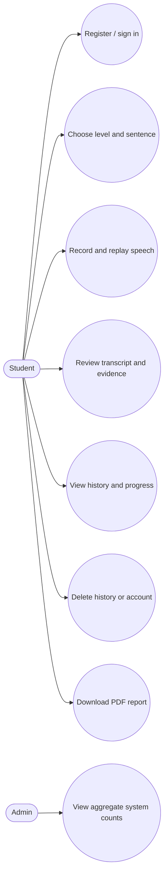
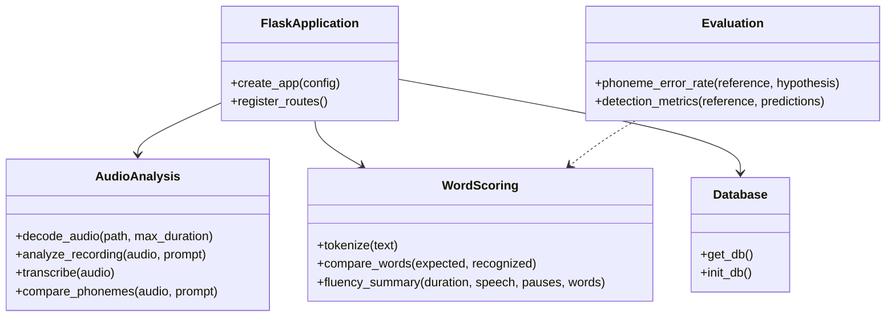
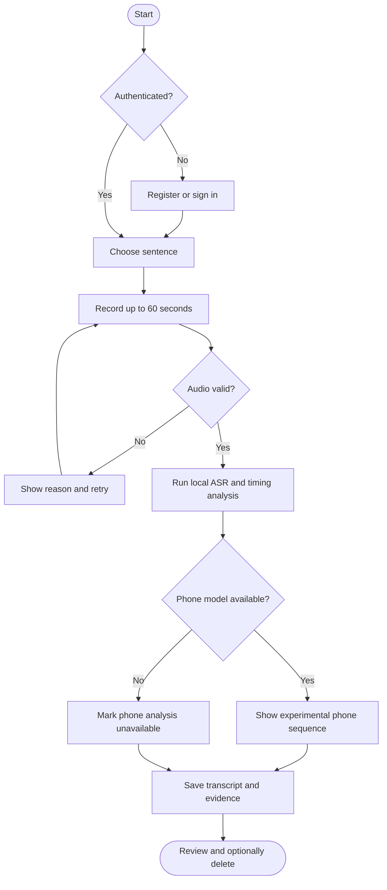

# Saywise Project Report

## Abstract

Saywise is a local-first English speech practice system that combines automatic speech recognition, lexical comparison with a known prompt, acoustic timing measurements, and an experimental phone-recognition path. Faster-Whisper supplies a transcript; deterministic edit alignment identifies recognized-word substitutions, omissions, and additions. A separate wav2vec2 checkpoint can emit phonetic labels for exploratory expected-versus-recognized phone comparison. Because that checkpoint is a phone recognizer rather than a pronunciation assessor, the system does not present its output as a validated pronunciation score. A suitable labeled dataset and speaker-independent evaluation are required before such a score can be claimed. SQLite stores accounts, practice attempts, transcripts, and analysis metadata. Recording retention is opt-in.

## Problem Statement

Basic speech-to-text systems do not reliably distinguish a learner's pronunciation mistake from an ASR error. Learners need feedback at the word and sound levels, but a transcript mismatch or forced alignment alone is not sufficient evidence that a phone was mispronounced. The project therefore needs a system that reports observable evidence, represents uncertainty, and provides an evaluation path using human-annotated pronunciation data.

## Objectives

1. Provide local English speech transcription and sentence practice.
2. Compare expected and recognized words with explicit insertion, deletion, and substitution alignment.
3. Generate an experimental phone sequence comparison using a separate phoneme-recognition acoustic model.
4. Report speaking duration, estimated speech duration, speaking rate, pause count, and longest pause without inventing a fluency grade.
5. Store practice history securely with password hashing, CSRF checks, user isolation, and audio retention consent.
6. Define dataset splits and metrics for a future calibrated pronunciation assessment.

## Literature and Model Selection

### Existing System

Speech-to-text applications produce transcripts, but transcript similarity does not measure phone quality. Forced aligners estimate where a supplied transcript fits an audio signal; they do not establish that the supplied words or phones were correctly produced. Rule-based word matching is useful for lexical practice but cannot substitute for acoustic pronunciation assessment.

### Proposed System

The application separates four forms of evidence: ASR transcript and word timestamps; expected-to-recognized lexical edit operations; phone labels from an acoustic phone recognizer; and timing features from decoded audio. The UI labels the phone recognizer as experimental and labels pronunciation and overall scores as not calibrated.

### Selected Models and Algorithms

| Component | Selection | Role and limitation |
|---|---|---|
| English ASR | Faster-Whisper with `small.en` default | Local transcription and word timestamps. It is not a pronunciation scoring model. |
| Phone recognizer | `facebook/wav2vec2-lv-60-espeak-cv-ft` | Recognizes phonetic labels after audio is resampled to 16 kHz. It was fine-tuned on multilingual Common Voice, not on pronunciation-quality labels; therefore its output is exploratory. |
| Reference phones | eSpeak NG through Phonemizer | Produces the reference phone sequence. Dictionary, stress, and accent variants must be controlled during evaluation. |
| Word comparison | Dynamic-programming Levenshtein alignment | Gives insertion/deletion/substitution evidence and WER. It does not attribute lexical edits to a pronunciation cause. |
| Timing | Short-window RMS energy segmentation | Estimates active speech and pauses. It is a transparent baseline, sensitive to noise and quiet speech. |
| Pronunciation scoring | Not released as a scalar score | A GOP-style or learned scorer is a research extension requiring human labels, calibration, and held-out evaluation. |

Pretrained components are Faster-Whisper and the wav2vec2 phoneme recognizer. Word alignment, RMS activity segmentation, reporting, and feedback selection are custom deterministic algorithms. The current app does not fine-tune any model.

## Feasibility and Scope

The Flask, SQLite, authentication, browser recording, word alignment, timing features, history, and PDF workflow are standard application work. ASR inference is practical on a CPU with a compact quantized model, with latency dependent on hardware. Phone inference adds a larger model download and optional PyTorch/eSpeak requirements. Phone mismatch output is an experimental research feature; calibrated pronunciation scoring is intentionally outside the current claim boundary until the dataset experiment supports it.

The app's frontend loads Chart.js and Google Fonts from CDNs. Speech processing is local after model weights have been downloaded and cached. The server may fetch weights on first inference. The current persistence layer is SQLite; MySQL is not implemented.

## System Architecture



### DFD Level 0



### DFD Level 1



## UML Views

### Use Cases



### Class / Module View



### Sequence: Analyze Attempt

```mermaid
sequenceDiagram
    actor Student
    participant UI as Browser UI
    participant API as Flask API
    participant Audio as Audio/ASR services
    participant DB as SQLite
    Student->>UI: Select sentence and record
    UI->>API: POST audio + sentence id + retention choice
    API->>API: Check session, CSRF, size, duration, decode
    API->>Audio: Resampled audio and expected sentence
    Audio->>Audio: ASR, timing features, optional phone comparison
    Audio-->>API: Transcript, edits, metrics, uncertainty status
    API->>DB: Store attempt; audio path only if consented
    API-->>UI: JSON analysis response
    UI-->>Student: Transcript, comparison, timing, feedback
```

### Activity



## Database Schema

| Table | Fields | Purpose |
|---|---|---|
| `users` | `id`, `email` unique, `display_name`, `password_hash`, `level`, `role`, `created_at` | Account, learning level, authorization. Passwords are never stored as plaintext. |
| `sentences` | `id`, `text`, `category`, `level` | Seeded practice prompts. |
| `attempts` | `id`, `user_id`, `sentence_id`, `sentence_text`, `recognized_text`, `analysis_json`, nullable `audio_path`, `created_at` | History, model outputs, consented recording reference. |

`attempts.user_id` references `users.id` with cascade deletion. Audio files are stored under `instance/recordings` and referenced only when retention was selected. SQLite is the implemented database; schema portability to MySQL has not been tested.

## Algorithms

### Word Error Alignment

Normalize text into case-folded alphanumeric tokens. Compute minimum edit distance with insertion, deletion, and substitution costs of one. Backtrace to retain a complete word-by-word alignment. Word error rate is $(S + D + I) / N$, where $N$ is the reference word count. An empty reference yields an undefined WER rather than division by zero.

### Fluency Features

Resample audio to 16 kHz mono. Compute RMS energy on 20 ms frames, threshold relative to the recording peak with a minimum floor, merge brief inactive gaps, and calculate active-speech duration and pauses of at least 250 ms. Speaking rate is recognized-word count divided by estimated active-speech time, expressed per minute. This is a baseline VAD heuristic, not a standardized fluency assessment.

### Phone Comparison

Generate a reference sequence with eSpeak NG and decode a phone sequence using the pretrained CTC phone recognizer. Compare the sequences for display. No calibrated GOP score, phone correctness probability, or error confidence is computed. A forced aligner may be added for timing experiments, but alignment alone cannot verify pronunciation.

### Feedback

Deterministic rules refer only to outputs that exist: transcript edits trigger a prompt to compare and repeat; a long detected pause triggers phrase-level practice advice; phone sequence differences are described as unverified review cues. The app never fabricates a phone substitution or score.

## Dataset and Research Methodology

### Primary Dataset

SpeechOcean762 provides 5,000 non-native English utterances with expert annotations at phone, word, and sentence level. The published corpus is predominantly Mandarin L1 and includes children and adults. Use its pronunciation and fluency labels to train/calibrate only after separating speakers into training, validation, and test sets. Preserve the official test partition when possible; tune thresholds only on validation speakers.

### Secondary Dataset

L2-ARCTIC includes 24 non-native English speakers across six L1 backgrounds and manual substitution, deletion, and addition labels for a selected subset. Use it as a cross-accent error-detection check only after confirming license and access conditions. Its CC BY-NC 4.0 terms prohibit some commercial uses.

### Evaluation Protocol

1. Document corpus version, license, selected fields, preprocessing, and exclusions.
2. Split by speaker, never by random utterance alone. Keep prompt overlap and speaker overlap visible in the report.
3. Evaluate ASR WER, phone PER where the phone inventories have been normalized, and error-detection precision, recall, and F1 against human tags.
4. For continuous human ratings, report MAE and correlation/agreement with rater references, and disclose inter-rater variability.
5. Report uncertainty, class imbalance, confidence intervals (speaker bootstrap preferred), and per-L1 subgroup results where sample sizes support them.
6. Compare the phone model baseline against a no-phone baseline and, if available, human annotations. Do not infer pronunciation quality from WER alone.
7. Keep all test labels out of model selection, threshold tuning, and calibration.
8. Add a consented, human-annotated Saywise sample only under an approved protocol; never silently repurpose student recordings for training.

### Metrics

- **WER:** substitutions + deletions + insertions divided by reference words.
- **PER:** phone edit distance divided by reference phones, after explicit phone-inventory mapping.
- **Detection:** precision, recall, and F1 for human-labeled phone/word error classes. Report per class as well as aggregate values.
- **Score calibration:** MAE and rank/linear correlation against human ratings. Compare with human-human agreement before interpreting system scores.
- **No results claimed:** model experiments have not yet been run in this project. The included functions compute metrics; they do not imply performance.

## Security, Privacy, and Ethics

Uploads are limited to 15 MB and 60 seconds, decoded before analysis, and restricted to a supported set of audio containers. Passwords use Werkzeug's password hash; mutating API routes require a session CSRF token; analysis/history routes require authentication and user ownership. Audio retention defaults off and users can delete one recording, all practice history, or the account. Transcripts and analysis metadata persist as practice history until deleted. Production use requires HTTPS, a persistent secret, deployment hardening, backups/deletion policy review, and explicit participant consent.

## Test Cases

| ID | Test | Expected result | Implemented check |
|---|---|---|---|
| T01 | Empty recognition against a prompt | All reference words are deletions; WER is 1 | Unit test |
| T02 | Extra recognized word | Insertion appears in correct alignment position | Unit test |
| T03 | Empty expected text | WER is undefined, no divide by zero | Unit test |
| T04 | Phone sequence differs by one phone | PER is computed by edit distance | Unit test |
| T05 | Error detector predictions | Precision, recall, F1 match confusion counts | Unit test |
| T06 | Missing CSRF header on mutation | Request is rejected | API test |
| T07 | Weak password registration | Registration is rejected | API test |
| T08 | Account registration | Password hash differs from plaintext | API test |
| T09 | Anonymous dashboard request | Request is rejected | API test |
| T10 | Invalid, silent, too-short, or too-long audio | Validation error; no attempt is stored | Manual/integration test with audio fixtures |
| T11 | Attempt deletion | User attempt and consented audio are removed | Manual/integration test |
| T12 | Local model unavailable | ASR returns actionable setup error; phone panel may be unavailable | Manual test |

## Results and Discussion

The implemented automated tests validate deterministic editing, metrics, API access controls, and registration behavior. They do not evaluate ASR accuracy, phone recognition, accent robustness, or pronunciation scoring. No model accuracy, F1, or learner outcome is claimed until the dataset protocol is executed and its outputs are added here. The app deliberately withholds a numeric pronunciation score in the current implementation.

## Limitations

- The phone recognizer is trained for phonetic-label recognition, not learner pronunciation scoring.
- eSpeak reference phones and recognizer phones may differ in normalization, stress, and phone inventory.
- Word mismatch can be caused by ASR, prompt variation, or recording quality rather than pronunciation.
- RMS activity detection can mistake noise for speech or omit quiet consonants.
- SpeechOcean762's learner population is limited; L2-ARCTIC is small and manually annotated only in part.
- No trained calibration model, custom fine-tuning, MySQL adapter, or model performance results are included.
- The Flask development server is for local use, not public production deployment.

## Future Scope

1. Pilot GOP-style likelihood features against the SpeechOcean762 phone-level scores and evaluate calibration speaker-disjointly.
2. Train a compact scoring head only if label coverage and held-out results justify it; retain an uncertainty/abstention path.
3. Validate phone confusion tags on L2-ARCTIC and a consented accent-balanced learner sample.
4. Add a robust VAD model and controlled forced alignment for timing, without treating alignment as correctness.
5. Add configurable MySQL persistence, migrations, deployment hardening, accessibility audits, and offline frontend assets.
6. Expand adaptive exercise selection only from verified repeated evidence and user history.

## Conclusion

Saywise provides an end-to-end practice workflow with local transcription, explicit lexical edits, timing measurements, account/history management, and optional phone-sequence comparison. It is a genuine speech-processing application, but its pronunciation assessment remains an experiment rather than a validated score. The project is designed to make that boundary visible and to provide a reproducible route from labeled data to a defensible assessment model.

## References

[1] J. Zhang, Z. Zhang, Y. Wang, Z. Yan, Q. Song, Y. Huang, K. Li, D. Povey, and Y. Wang, “speechocean762: An Open-Source Non-native English Speech Corpus for Pronunciation Assessment,” *Proc. Interspeech*, 2021. [Online]. Available: https://arxiv.org/abs/2104.01378.

[2] G. Zhao, S. Sonsaat, A. Silpachai, I. Lucic, E. Chukharev-Hudilainen, J. Levis, and R. Gutierrez-Osuna, “L2-ARCTIC: A Non-native English Speech Corpus,” *Proc. Interspeech*, pp. 2783–2787, 2018, doi: 10.21437/Interspeech.2018-1110.

[3] Q. Xu, A. Baevski, and M. Auli, “Simple and Effective Zero-shot Cross-lingual Phoneme Recognition,” arXiv:2109.11680, 2021. [Online]. Available: https://arxiv.org/abs/2109.11680.

[4] S. McAuliffe, M. Socolof, S. Mihuc, M. Wagner, and M. Sonderegger, “Montreal Forced Aligner: Trainable Text-Speech Alignment Using Kaldi,” *Proc. Interspeech*, pp. 498–502, 2017.

[5] P. C. Bagshaw, S. M. Hiller, and M. A. Jack, “A combined phoneme- and prosody-based approach to automatic assessment of English spoken by non-native speakers,” *Proc. ICSLP*, 1996.

[6] SYSTRAN, “Faster-Whisper: Faster Whisper transcription with CTranslate2,” source repository. [Online]. Available: https://github.com/SYSTRAN/faster-whisper.

[7] Meta AI, “wav2vec2-lv-60-espeak-cv-ft,” model card. [Online]. Available: https://huggingface.co/facebook/wav2vec2-lv-60-espeak-cv-ft.